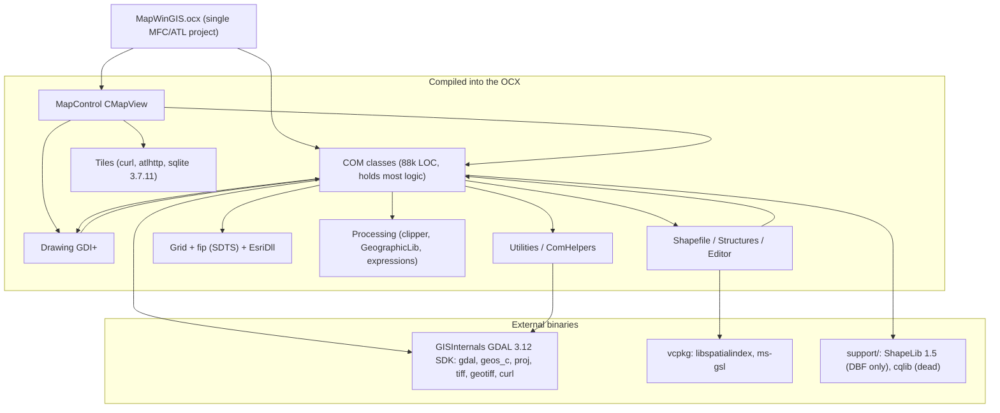
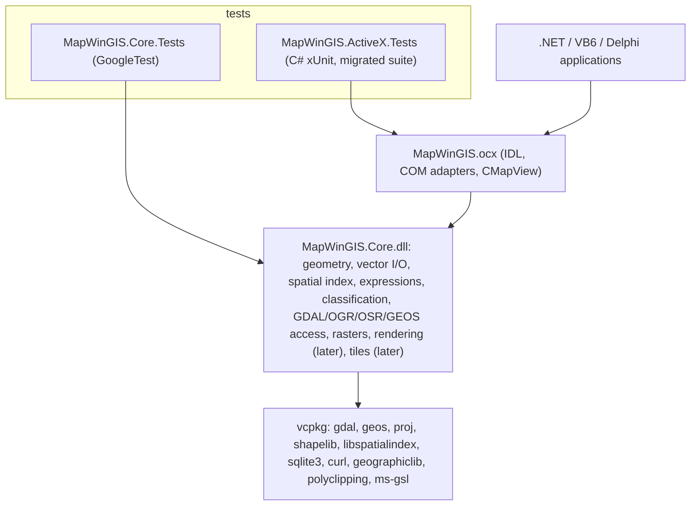

# MapWinGIS6: architecture analysis and migration plan

Status: reviewed. Decisions D0–D7 are settled (section 0). Step 1 has an implemented x64 vertical slice; Win32 remains pending.

- Reference code base (read-only): `F:\dev\MapWindow\MapWinGIS\git\MapWinGIS`, branch `develop`, commit `c08894b4` (2026-08-20).
- New development location: `F:\dev\MapWindow-new\MapWinGIS6`, remote `https://github.com/MapWindow/MapWinGIS6.git`.
- Related plan: [gdal-msvc2026-build.md](gdal-msvc2026-build.md), which covers the GISInternals-style GDAL build for MSVC 2026 (`vc18`). With D2 settled, that work is no longer on the critical path.

The document has two kinds of content, and it tries to keep them apart:

- **Findings**: facts taken from the source, project files, the local machine, or upstream vcpkg files. File references are relative to the old repository root unless stated otherwise.
- **Recommendations**: proposals, now mostly settled by the decisions in section 0.

### Implementation checkpoint (2026-10-01)

This is the verified continuation point for the next session:

| Area | Status | Evidence / next action |
|---|---|---|
| New repository | In progress | `F:\dev\MapWindow-new\MapWinGIS6`, remote `MapWindow/MapWinGIS6`; changes are currently uncommitted on `main` |
| vcpkg | Complete for x64 | Independent checkout at `F:\dev\MapWindow-new\vcpkg`, pinned to `a42757564758c60651ebc616d9b000b7b91249ef`; GDAL 3.12.4, GEOS 3.15.0, PROJ 9.9.0, GoogleTest 1.18.0, v145 triplet |
| `MapWinGIS.Core.dll` | Implemented for the first slice | `GdalEnvironment`, `VectorDataset`, `VectorLayer`, `FieldInfo`, `Extent`, core enums and errors |
| Vector read API | Implemented and tested | OGR-backed open, layers, feature count, shape type, extents, fields, null-aware typed values, WKT geometry and projection WKT |
| Vector edit API | Implemented and tested | Update mode, string/double/integer/null field edits, WKT geometry edits, flush-on-close, reopen verification |
| Caching | First pass complete | Most-recently-used feature cache, cached feature count and extent, deferred index-to-FID map with ignored fields during the scan; feature-level batched edits and a benchmark remain open |
| Test data | Implemented | `tests/data/provinces` exists as Shapefile and GeoPackage; CSV/VRT sources and `generate-testdata.ps1` regenerate it |
| x64 Debug | Green | Clean build, no warnings; 59/59 GoogleTest cases pass |
| x64 Release | Green | Clean build; 59/59 GoogleTest cases pass |
| Win32 Debug/Release | **Pending** | No `vcpkg_installed\x86-windows-v145\include\gdal.h` or Win32 test executable exists yet; install/build the x86 manifest before claiming architecture parity |
| ActiveX layer | Not started | The OCX, typelib 6.0, COM adapters and compatibility tests remain roadmap work |

The next practical action is to finish the x86 vcpkg install and build/test Win32. After both architectures are green, continue with the driver-parity report and then the foundation/projection work in steps 2–5. Do not start the ActiveX layer yet.

---

## 0. Decisions (settled)

| # | Decision | Outcome | Consequences |
|---|---|---|---|
| D0 | Target folder | `F:\dev\MapWindow-new\MapWinGIS6`, remote `MapWindow/MapWinGIS6` | |
| D1 | Name of the native core DLL | **`MapWinGIS.Core.dll`** | Avoids the collision with the `MapWinGIS.dll` interop assembly that `tlbimp`/`aximp` produce |
| D2 | GDAL provider | **vcpkg only.** No SDK provider switch, no `Gdal.Provider.props` | Drops the manual SDK download, the `$(PlatformToolset)` folder layout and `CopyTamasFiles.bat`. Also drops ECW, MrSID, HDF4, FileGDB-SDK and OCI, which are not in vcpkg. `OpenFileGDB` reads and writes File Geodatabases, so `FileGDB` is covered. **This is a user-visible change and belongs in the release notes.** The `vc18` GISInternals build is no longer needed for MapWinGIS6 |
| D3 | Typelib version | **`version(6.0)`**, LIBID unchanged | "Highest possible" is 65535.65535, which would leave no room for later releases, so 6.0 it is. The LIBID stays the same so that the `MapWinGIS` namespace and the IIDs keep resolving. Existing .NET `COMReference` entries pin `VersionMajor=5 VersionMinor=4` and must be updated to 6.0; compiled applications keep working because the IIDs and CLSIDs don't change |
| D4 | Minimum Windows version | **Windows 11** (`_WIN32_WINNT=0x0A00`, `NTDDI_VERSION=NTDDI_WIN10_CO`) | Windows 10 reached end of support in October 2025. Users on Windows 10 stay on MapWinGIS 5.x. Release-note item |
| D5 | Architectures | **Win32 and x64** | |
| D6 | Legacy grid code | **Remove** `Grid/EsriDll`, `COM classes/ESRIGridManager` and `Grid/fip` (ISO 8211 / SDTS), and with them `dGrid`/`fGrid`/`lGrid`/`sGrid` | About 53k lines disappear. `IESRIGridManager` stays in the IDL and reports "not available". SDTS and ArcInfo binary grids are read through the GDAL `SDTS` and `AIG` drivers instead. **Behaviour change for anyone still writing ESRI grids through ArcInfo** |
| D7 | GDAL feature licences | Only licences compatible with MPL-2.0 | Excludes `poppler` (GPL), so the GDAL `PDF` driver is not built. Everything in the vcpkg GDAL default feature set is permissive, MPL or tri-licensed. Verified per feature in step 2 |

### 0.1 Follow-up decisions from the review

| Topic | Outcome |
|---|---|
| **Axis order** | Use the GDAL 3 default (`OAMS_AUTHORITY_COMPLIANT`). Remove `CGeoProjection::CorrectAxisOrder` and the single `SetAxisMappingStrategy` call. The core exposes the strategy as an explicit option per `SpatialReference`, defaulting to the GDAL default. **This can swap lat/lon for EPSG:4326 compared with 5.x**, so it needs a prominent release note and a characterization test that records the difference |
| **GDAL error handling** | One `CPLSetErrorHandlerEx` installed by `GdalEnvironment`, with user data instead of globals. Temporary changes always use `CPLErrorHandlerPusher` / `CPLErrorStateBackuper` (RAII, from `cpl_error.h`), so no handler is ever leaked. The "suppress errors" global flag disappears |
| **GDAL tools** | Use the `gdal_utils.h` API (`GDALInfo`, `GDALTranslate`, `GDALWarp`, `GDALRasterize`, `GDALBuildVRT`, `GDALVectorTranslate`, `GDALVectorInfo`). The 11k lines of ported command-line code in `Utils_GDAL.cpp` and `Utils_OGR.cpp` are not carried over. This also fixes the `OGR_ENABLED` dead paths (cutlines, tile indexes) |
| **`"Ascii"` driver** | Bug. `tkGridRaster.cpp:1069` uses `"Ascii"`, which is not a GDAL driver. Use `"AAIGrid"` |
| **SQLite** | vcpkg `sqlite3` (latest stable, shared with GDAL). The 3.7.11 amalgamation and `shell.c` are dropped |
| **HTTP proxy** | Replace the ATL Server `atlhttp` headers with **WinHTTP** (`WinHttpGetIEProxyConfigForCurrentUser`, `WinHttpGetProxyForUrl`) from the Windows SDK, which is the supported replacement. Basic auth moves to libcurl's own options (`CURLOPT_USERPWD`, `CURLOPT_HTTPAUTH`). No new third-party dependency |
| **`shapefil.h` mismatch** | Use the vcpkg `shapelib` 1.6.3 headers and library together. `support/include/ShapeLib/shapefil.h` and the orphaned `src/Shapefile/dbfopen.cpp` are not carried over |
| **cqlib** | Removed |
| **Debug builds** | Real `Debug` configuration: `/MDd`, `_DEBUG`, vcpkg debug dependencies, debug CRT heap checks. `VLD` and `MemLeakDetect` are dropped; AddressSanitizer is available through an opt-in property |
| **Toolchain spike (old step 0)** | Dropped. You already tried building 5.x with v145 without success, and the spike's only purpose was to gather migration issues. The known ones are listed in section G, step 0, and will be met one file at a time during the copy |

### 0.2 Is a shapefile still the right internal format?

**Finding:** MapWinGIS 5 does not write a temporary shapefile on disk. `Ogr2Shape::CreateShapefile` (`src/Ogr/Ogr2Shape.cpp:30`) calls `sf->CreateNew("", shpType)` with an **empty file name**, which produces an in-memory `CShapefile`. So the internal format is not the shapefile file format. It is the in-memory object model: `std::vector<ShapeRecord*>` plus a `CTableClass` of attributes.

What that model does inherit from the shapefile format, and what actually constrains things:

- one geometry type per layer (`ShpfileType`), with a `NullShape` fallback;
- the five DBF field types (`STRING`, `INTEGER`, `DOUBLE`, `BOOLEAN`, `DATE`), 10-character field names and a 254-character string limit;
- no 64-bit feature ids, no proper null values, no curve geometries.

**Recommendation: keep an in-memory feature collection, and do not adopt GPKG as an internal format.**

- GPKG is a *file* format backed by SQLite. Using it internally would mean a temporary file (or a `/vsimem` database) and a SQL round trip for every attribute read, in exchange for capabilities the in-memory model doesn't need.
- GDAL's `MEM` vector driver would be the natural choice if we wanted GDAL to own the model, but it would put a GDAL dataset behind every layer, including purely computed ones.
- The real improvement is to widen the *model*, not to change the format: 64-bit ids, true nulls, `std::variant` field values, UTF-8 names without the 10-character limit, and geometry stored as OGR-compatible WKB.

**Where GPKG should be used** is as the recommended *storage* format: the default for "save a layer", the tile cache (GPKG is also a tile format), and a replacement for the custom `.mwd`/`.dat` spatial index sidecars. That is a later step and does not affect the core's in-memory model.

### 0.3 Widening the in-memory feature model, and adopting GPKG as a storage format

Two separate work items that follow from 0.2. Neither is on the critical path, but both should happen before the ActiveX layer is finalized, because the second one adds new COM API surface.

#### A. Widen the in-memory model (part of step 6)

The in-memory feature collection replaces `CShapefile`-without-a-filename. It should drop the limits the shapefile format imposed:

| Today (inherited from the shapefile format) | MapWinGIS 6 |
|---|---|
| 32-bit shape index | 64-bit feature id (`std::int64_t`), matching OGR |
| No null attribute values; "empty" means 0 or "" | Explicit null, distinct from 0 and "" |
| 5 field types (`STRING`, `INTEGER`, `DOUBLE`, `BOOLEAN`, `DATE`) | `std::variant` over string, int64, double, bool, date/time, binary, and integer/real/string lists |
| Field names limited to 10 characters, ANSI | UTF-8 names of any length |
| String values limited to 254 characters | No limit |
| One geometry type per layer, `NullShape` fallback | Geometry type per feature, with an optional layer-level constraint |
| No curve geometries | WKB storage, so curves survive a round trip even when MapWinGIS does not draw them |
| Geometry stored in the shapefile record layout | OGR-compatible WKB, so conversion to and from OGR is a memcpy rather than a per-vertex loop |

Compatibility: the ActiveX layer keeps the old `ITable`/`IField`/`IShape` semantics. When a value does not fit the old model (a 64-bit id, a list field, a long string) the COM getter truncates or coerces exactly as 5.x would, and new behaviour is reachable only through new members. The `ShapeType` and `FieldType` enum values stay as they are.

#### B. GPKG as the recommended storage format (a step of its own, after step 6)

GeoPackage should become the format MapWinGIS recommends and defaults to for new data, because it removes exactly the limits listed above and is a single file rather than a five-file set.

Three concrete uses, in increasing order of size:

1. **Saving layers.** `Shapefile.SaveAs` keeps writing shapefiles. Add a format-aware save (for example `SaveToFile(filename, format)`) that defaults to GPKG when the extension is `.gpkg`. Only additive COM changes.
2. **Replacing the spatial index sidecars.** MapWinGIS 5 writes `.dat`/`.idx` files through libspatialindex, and migrates older `.mwd`/`.mwx` files ([src/COM classes/Shapefile_SpatialIndex.cpp](../../MapWindow/MapWinGIS/git/MapWinGIS/src/COM%20classes/Shapefile_SpatialIndex.cpp)). A GPKG carries an R-tree index inside the file, so a layer stored as GPKG needs no sidecar and no libspatialindex at all. Shapefiles keep the existing sidecar mechanism, so nothing breaks for current users. This is what would eventually let the `libspatialindex` dependency be dropped.
3. **Tile cache.** The tile cache is already SQLite ([src/Tiles/Caching/SQLiteCache.cpp](../../MapWindow/MapWinGIS/git/MapWinGIS/src/Tiles/Caching/SQLiteCache.cpp)) with a MapWinGIS-specific schema. GPKG standardises a tile schema, so a GPKG tile cache could be opened by QGIS and others. Risk: existing caches would have to be migrated or discarded, and GPKG's tile matrix set is stricter than the current free-form schema. Decide this when step 10 starts.

What GPKG does **not** replace: the shapefile reader and writer (users keep sending shapefiles), and the map-state XML.

---

## A. Current architecture analysis (findings)

### A.1 Solutions and projects

| File | Toolset / SDK | Status |
|---|---|---|
| `src/MapWinGIS.sln` + `src/MapWinGIS.vcxproj` | v143, `WindowsTargetPlatformVersion=10.0` | **Current.** One project producing `MapWinGIS.ocx` |
| `support/SupportLibs.sln` (cqlib, ShapeLib) | v143, SDK 10.0 | Current, built in CI |
| `src/MapWinGIS-VS2015.*`, `src/MapWinGIS-toolset141.*`, `support/SupportLibs-VS2015.sln`, `support/SupportLibs-toolset141.sln`, `cqlib-*.vcxproj`, `ShapeLib-*.vcxproj` | v140/v141, SDK 8.1 / 10.0.17134 / 10.0.17763 | **Stale and broken.** They reference the old `Control\` folder, `SpatialIndex-mw.lib` and `libtiff_i.lib` |
| `support/spatialindex` (libspatialindex 1.8.1, MapWinGIS-modified) | v142 | Obsolete. Replaced by vcpkg `libspatialindex` |
| `MapWinGisTests-net/MapWinGisTests-net.sln` | .NET 10, xUnit | **Current test suite**, run by CI |
| `unittests/`, `test/`, `demo/`, `src/MapWinGisTests-net/` | .NET Framework 4.0–4.8 | Stale |

The whole engine, about 187k hand-written lines, is **a single MFC DLL project**. There are no internal libraries: every folder under `src/` compiles into the OCX.

### A.2 How `MapWinGIS.ocx` is built today (item 13)

1. Download four GISInternals ZIPs manually (currently `release-1944-*-gdal-3-12-1-mapserver-8-6-0*.zip`; CI uses GDAL 3.10.3 / MSVC 1930 from `MapWindow/Dependencies`).
2. Run `support/unpackGdal3-Toolset143-GISInternals.ps1`. It fills `support/GDAL_SDK/v143/{bin,include,lib}/{win32,x64}`.
3. Build `support/SupportLibs.sln` (Release). This produces `support/lib/v143/<platform>/Release/{cqlib,ShapeLib}.lib`.
4. Build `src/MapWinGIS.sln`:
   - vcpkg manifest mode (`src/vcpkg.json`) installs `ms-gsl` and `libspatialindex` into `src/vcpkg_installed/<triplet>`.
   - The pre-build step `CopyTamasFiles.bat` copies GDAL DLLs, plugins, `gdal-data` and `proj9/share` next to the output.
   - MIDL compiles `MapWinGIS.idl` into `MapWinGIS_i.h`, `_i.c`, `_p.c` and `dlldata.c`. These generated files are **committed to the repo**. The type library is embedded as resource 2.
   - The linker uses `MapWinGIS.def`, `TargetExt=.ocx` and `RegisterOutput=true` with `PerUserRedirection` (the OCX is registered in HKCU).
   - Linked libraries: `gdal_i geos_c tiff geotiff libcurl_imp cqlib ShapeLib spatialindex-32/64 GdiPlus version Crypt32 Dbghelp`.
   - The post-build step runs **`setx`** for `MapWinGISBin32/64` and **`PROJ_LIB`**. This permanently changes the developer's user environment and can break other GIS software on the machine.
5. For a release, bump the version in four places (`src/changingVersionNumbers.txt`) and build Inno Setup by hand (`src/InnoSetup/MapWinGIS-only.iss`, which contains hard-coded `D:\dev` paths).

Project settings worth knowing about:

- `CharacterSet=MultiByte`, `UseOfMfc=true` (`_AFXDLL`), and C++14 / C11 in every configuration.
- **The "Debug" configuration does not define `_DEBUG` and uses the release CRT (`/MD`).** The GISInternals binaries are release-only, so this is the only safe option with them. As a result, `#ifdef _DEBUG` code (MemLeakDetect, the eager `GDALAllRegister`) never runs, and there is no real debug build.
- `RandomizedBaseAddress=false` (ASLR off) and `BufferSecurityCheck=false` (`/GS-`). Both are security regressions.
- The include path lists `$(ProjectDir)\Control`, which no longer exists. `src/MapWinGIS.vcxproj.user` points at renamed test folders.

### A.3 Where the functionality lives, and COM/MFC coupling (items 3, 4, 9, 14)

Line counts are approximate.

| Area | Lines | MFC | ATL/COM | GDI/GDI+ | Assessment |
|---|---|---|---|---|---|
| `COM classes/` (53 coclasses) | 88k | heavy | heavy | some | COM layer, **but it also holds most of the real logic**: geoprocessing, DBF/table, the GDAL/OGR utilities, shapefile I/O |
| `MapControl/` (`CMapView : COleControl`) | 21k | heavy | heavy | heavy | ActiveX control: dispatch map (113 functions, 149 properties), 40 events, GDI+ back buffers, Win32 messages |
| `ComHelpers/` | 3.7k | light | heavy | light | Helpers written against COM interfaces |
| `Drawing/` | 9.2k | CString, CRect | takes `IShapefile*`, `ILabels*`, `ICharts*` and casts them to `CShapefile*` etc. | heavy (GDI+) | Rendering. Needs refactoring |
| `Editor/` | 3.1k | light | `IShape*`, `IShapeEditor*`, `IUndoList*` | GDI+ | Needs refactoring |
| `Ogr/` | 4.0k | light | returns `IShapefile*` / `IShape*` | none | Needs refactoring (GEOS helpers are clean) |
| `Shapefile/` | 7.2k | light | `ShapeRecord` holds `IShape*`; `IShapeWrapper` exposes `IPoint*` | none | Mostly clean. **Good first candidate** |
| `Structures/` | 1.4k | light | `Layer` holds `IDispatch*` and `BSTR` | none | Needs refactoring |
| `Processing/` (own code) | 6.8k | light | some | little | Mixed. Several files are clean |
| `Grid/` + `Grid/fip` | 22k + 31k | CString | `IGrid*` in `GridInterpolate` | none | Mostly clean. `fip` is third-party C code |
| `Image/` | 5.9k | light | `GdalRaster` holds `IGridColorScheme*`, `ICallback*` | some | Mixed |
| `Tiles/` | 7k | CString, CRect | `ICallback*`, `IGeoProjection*`, `IMapViewCallback*` | little | Mostly clean. HTTP uses curl plus old ATL Server headers |
| `Tin/`, `ShapeNetwork/` | 1k | none | none | none | **Clean** |
| `Utilities/` | 6.8k | mixed | mixed | little | Mixed. Many clean helpers |

How the COM types are woven through the code:

- **COM is the internal object model.**
  - `CShapefile` owns the shape records, file handles and locks, plus `ITable*`, `ILabels*`, `ICharts*` and categories.
  - The drawing code receives COM interfaces and casts them down to implementation classes (about 230 casts in total). For example, `static_cast<CShapefile*>(sf)->get_File()` in `Drawing/ShapefileDrawing.cpp`.
- **Internal objects are created through COM activation.**
  - `CoCreateInstance` is called about 160 times and `ComHelper::CreateInstance/CreatePoint/CreateShape` about 220 times.
  - `GlobalClassFactory` calls `CoGetClassObject` during DLL static initialization (under the loader lock).
  - As a result, even internal code only works when the OCX is registered, or when an activation context is present.
- **Global state:**
  - `m_globalSettings` (`GlobalSettingsInfo`, about 80 fields including `ICallback*`, `CString` and `BSTR`) is used about 400 times.
  - `m_utils` / `GetUtils()` means the engine calls its own public COM API.
  - There is one process-wide GEOS context that is never freed.
  - Tile caches and proxy settings are static.
- **The precompiled header (`StdAfx.h` → `GlobalVars.h`) is included by every translation unit.** It pulls in MFC, ATL, GDAL, GEOS, GDI+, the MIDL header and the globals. Headers that look self-contained actually depend on the PCH for `CString`, `CRect`, `OLE_COLOR` and the IDL enums (`ShpfileType`, `tk*`).
- **Strings:**
  - MBCS `CString` is assumed everywhere. There are about 465 uses of `USES_CONVERSION` and about 620 `W2A`/`A2W`/`OLE2A` conversions.
  - File names are mostly handled as `CStringW`, then converted to UTF-8.
  - `GDAL_FILENAME_IS_UTF8` is switched to `NO` at startup and toggled YES→NO around each open. This is a process-global setting and races with background threads.

**Files that are already pure C++**, the first extraction candidates (no MFC, ATL, IDL or GDI apart from what the PCH supplies):

- `Tin/*`, `ShapeNetwork/*`
- `Processing/`: `Base64`, `JenksBreaks`, `QTree`, `clipper`, `GeograpicLib/*`. `ExpressionParser` and `ExpressionParts` need only `CStringW`.
- `Utilities/`: `ColoringGraph`, `cppVector`, `vertex`, `Matrix`, `LineBresenham`, `HashTable`, `Timer*`, `X/YRedBlackTree`, `GeographLibHelper`, `SpatialIndex/*`
- `Shapefile/`: `ShapeData`, `ShapeWrapper`, `ShapeWrapperPoint` (except the `IPoint` accessors), `ShapeUtility`, `ShapeInterfaces`, `TableRow`, `dbf` (`CStringW`)
- `Image/`: `RasterMatrix`, `HistogramData`, `ImageStructs`, `ImageGroup`
- `Grid/`: `dGrid`, `fGrid`, `lGrid`, `sGrid` and their headers (only `CString`), `GenericGrid`
- `Drawing/`: `CollisionList`, `RotatedRectangle`, `LabelDrawingHelper` (`CRect`), `PointSymbols`
- `MapControl/`: `ErrorCodes`, `Enumerations.h`
- `Tiles/`: `Providers/*` (only `CString`), `Caching/*` (`CString`, `CRect`)

### A.4 Public COM surface (must stay stable)

- `library MapWinGIS`, LIBID `C368D713-CC5F-40ED-9F53-F84FE197B96A`, `version(5.4)`.
- Map control: CLSID `54F4C2F7-ED40-43B7-9D6F-E45965DF7F95`, ProgID `MAPWINGIS.Map.1`. The dispinterface `_DMap` has uuid `1D077739-E866-46A0-B256-8AECC04F2312`; the event interface is `_DMapEvents`.
- 53 effective coclasses, 54 effective dual interfaces derived from `IDispatch`, and 144 enums.
- Parts of `_DMap` are grouped with `#ifdef` (`OLD_API`, `REDRAW_API`, ...). `OBSOLETE_API` members are still compiled in as `hidden`.
- Three module objects live side by side: MFC `COleControlModule`, ATL7 `CAtlMfcModule` and ATL3 `CComModule` (the last one only for two `OLD_API` classes).
- At least 26 `.rgs` files register `ThreadingModel=Both`. `StdAfx.h` sets `_ATL_FREE_THREADED`.
- `Grid/*.h` classes are declared `__declspec(dllexport)`, so the OCX probably exports C++ symbols beyond its `.def`. This has not been checked with `dumpbin`.

### A.5 Third-party libraries (items 5–8)

| Library | How it is used today | Findings |
|---|---|---|
| **GDAL/OGR/OSR/CPL 3.12.1** | GISInternals SDK, `gdal_i.lib`, headers pulled into every translation unit | Details in section A.6 |
| **GEOS** | `geos_c.lib` from the GDAL SDK. All calls go through `Ogr/GeosHelper.h` (reentrant `*_r` API, since `GEOS_NEW` is defined) | Geometries are exchanged with GDAL through `exportToGEOS` / `createFromGEOS`, so MapWinGIS **must use the same `geos_c.dll` as GDAL**. There is one global context, used from several threads |
| **PROJ 9** | Only indirectly through OSR | Data comes from `proj9/share`. `PROJ_LIB` is set as a CPL config option, and globally with `setx` |
| **libtiff / libgeotiff** | Linked directly | Only used in `CUtils::IsTiffGrid` (`Utils.cpp`) and `GridManager::getGridDataType`. The geotiff includes in `Map_Core.cpp` are unused. Both uses can be replaced with GDAL calls |
| **libcurl** | From the GDAL SDK | Used by `Tiles/Http/SecureHttpClient.cpp`. `curl_global_init`/`cleanup` run **per map control instance** (`Map.cpp:328/454`), which is not thread-safe |
| **ShapeLib 1.5.0** (`support/ShapeLib`) | Static lib. Only `dbfopen.c`, `safileio.c` and `shpopen.c` are compiled | **Only the DBF part is used** (`TableClass.cpp` via `DBFOpen_MW`/`DBFCreate_MW` in `Shapefile/dbf.cpp`, which switches the CRT locale to `.UTF8`). The `.shp`/`.shx` files are read and written by MapWinGIS's own code. The code is compiled against `support/include/ShapeLib/shapefil.h` (a GDAL-flavoured 2017 copy) but linked against the 1.5.0 build: **the headers don't match.** `src/Shapefile/dbfopen.cpp` is an orphaned 2009 copy that isn't in the project |
| **cqlib** (Wu color quantizer) | `cqlib.lib` is linked and built in CI | **Dead code.** `main_cq()` has no callers. The last caller, `tkGif`, was deleted in 2015 (commit `d1cda465`). The code relies on globals and calls `exit(1)` when an allocation fails |
| **libspatialindex 2.1.0** | vcpkg | Used by `Utilities/SpatialIndex/*` and `Shapefile_SpatialIndex.cpp`. Old `.mwd/.mwx` indexes are migrated to `.dat/.idx` |
| **ms-gsl 4.2.2** | vcpkg | About 15 files |
| **SQLite 3.7.11** (from 2012) | Amalgamation in `Utilities/SQLite` | Used only by the tile cache. `shell.c` (the CLI, which contains `main`) is **compiled into the OCX**. This version has known CVEs |
| **Clipper 6.4.2** | Source in `Processing/` | Available in vcpkg as `polyclipping`. The newer Clipper2 is a separate port |
| **GeographicLib 1.32** (from 2013) | Source in `Processing/GeograpicLib` | Only Geodesic, GeodesicLine and PolygonArea are used. vcpkg has `geographiclib` 2.x |
| **ATL Server `atlhttp`** (VS2008 era) | `support/include/atlhttp` | Still used for proxy auto-detection (`Tiles/Http/HttpProxyHelper.cpp`) and `BasicAuth.h` |
| **FIPS 123 / ISO 8211** (`Grid/fip`, 94 files) | Compiled into the OCX | Used by `dGrid`/`fGrid`/`lGrid`/`sGrid` for SDTS grids |
| **ESRI grid DLL loader** (`Grid/EsriDll`) | Runtime `LoadLibrary` of `avgridio.dll`/`aigridio.dll` found through the registry | Only works if ArcView/ArcInfo is installed |
| **VLD / MemLeakDetect** | Optional | VLD has to be installed separately. MemLeakDetect never runs because `_DEBUG` is never defined |
| **Boost** | Not used | |

### A.6 GDAL/OGR integration (item 5)

- **Initialization:**
  - `GDALAllRegister` is called lazily, 25 times across 8 files.
  - `OGRRegisterAll` is called 7 times.
  - The eager call in `MapWinGIS.cpp` only runs under `_DEBUG`, which is never defined.
  - `GDALDestroyDriverManager` is never called.
- **Data paths:** `GdalHelper::SetDefaultConfigPaths` sets `GDAL_DATA`, `GDAL_DRIVER_PATH` (`gdalplugins`) and `PROJ_LIB` as CPL config options, and calls `SetDllDirectoryW`. Neither `PROJ_DATA` nor `OSRSetPROJSearchPaths` is used.
- **Error handling:**
  - The process-wide `CPLSetErrorHandler(CustomCPLErrorHandler)` forwards errors to the global COM `ICallback`.
  - `CUtils::CopyNodataValues` **replaces the global handler and never restores it**.
  - A global `suppressGdalErrors` flag is toggled around operations, which is not thread-safe.
- **Ported command-line tools:**
  - `Utils_GDAL.cpp` (6.8k lines) contains old copies of gdalinfo, gdal_translate, gdal_rasterize, gdalwarp, gdalbuildvrt, gdaladdo, gdal_polygonize and gdal_contour.
  - `Utils_OGR.cpp` (4.2k lines) contains copies of ogr2ogr and ogrinfo.
  - Only `GdalUtils.cpp` uses the modern `gdal_utils.h` API.
  - `OGR_ENABLED` is never defined, so gdalwarp cutlines and tile-index input in the ported code **always fail**.
- **Legacy APIs in use:**
  - `OGRSFDriverRegistrar`, `OGROpen`, `OGR_DS_*`/`OGR_Dr_*`, and `dynamic_cast<OGRSFDriver*>`, which almost always returns null in GDAL 3.
  - The private header `gdal_alg_priv.h`.
  - `importFromProj4`/`exportToProj4`, `morphToESRI`/`morphFromESRI`.
  - The WKT-string raster SRS API (`GetProjectionRef`/`SetProjection`); `GetSpatialRef` is never used for rasters.
- **Axis order:**
  - `SetAxisMappingStrategy(OAMS_TRADITIONAL_GIS_ORDER)` is set **only** in the `CGeoProjection` constructor.
  - The roughly 20 other SRS objects created in `Utils_GDAL.cpp`, `Utils_OGR.cpp` and `Processing/Projections.cpp` use the GDAL 3 default (authority-compliant order).
  - A WKT-rewriting workaround exists in `CGeoProjection::CorrectAxisOrder`.
  - This is the most likely source of lat/lon swaps.
- **NoData:** `GetNoDataValue()` is often called without checking `pbSuccess`.
- **Unmanaged memory:** `CPLMalloc`/`CPLFree`/`CSL*` are used about 400 times, with no RAII (`GDALDatasetUniquePtr` is unused).
- **Serialization:** `cpl_minixml` (`CPLXMLNode`) is the project's XML serialization layer, about 790 calls in 44 files. Map state and layer files depend on it.
- **Threading:** MFC `CCriticalSection`s protect background OGR loading, and a `std::mutex` protects the shared OGR connection cache. There are no GDAL-level locks.
- **Driver names referenced in code:** `GTiff`, `ESRI Shapefile`, `AAIGrid`, `EHdr`, `DTED`, `ECW`, `BMP`, `HFA`, `VRT`, `PostgreSQL`, `SQLite`, `FileGDB`, `MapInfo File`, `GeoJSON`, `CSV`, `GML`, `DXF`, `MySQL`, `MSSQLSpatial`, `OCI`, `WFS`. `"Ascii"` in `tkGridRaster.cpp:1069` is **not a valid GDAL driver name** and looks like a bug.

### A.7 Toolset and SDK dependencies (items 10, 11)

- **v143:** `MapWinGIS.vcxproj`, `cqlib.vcxproj`, `ShapeLib.vcxproj`.
  - The dependency on v143 is mostly **path-based**. The GDAL SDK and support libraries live under `$(PlatformToolset)` folders (`GDAL_SDK\v143`, `support\lib\v143`), so switching the toolset breaks every include and lib path.
  - Microsoft's C++ binary-compatibility guarantee covers 2015 through 2026. A GDAL built with v143 should therefore link into a v145 build, provided the final link uses v145 and the newest VC++ redistributable is deployed. **Verify this with the toolset spike (step 0).**
- **Windows SDK:** the current project uses `10.0`, meaning "latest installed", so it is **not** tied to an old SDK. The outdated parts are:
  - the stale VS2015 and toolset141 projects (SDK 8.1, 10.0.17134, 10.0.17763);
  - the **API level** in `StdAfx.h` (`WINVER/_WIN32_WINNT 0x0502`, `_WIN32_IE 0x0600`).
- **ATL/MFC:** only `MapWinGIS.vcxproj`. The support libraries don't use them.
- **Installed on this machine:**
  - VS Community 2026 18.10 with MSVC 14.51.36231 (**v145**) and ATL/MFC for x86 and x64.
  - VS Build Tools 2022 17.14 (v143).
  - Windows SDKs 10.0.19041, 22621, 26100 and **28000**.

### A.8 Tests (item 12)

- **`MapWinGisTests-net/`** (active):
  - .NET 10, xUnit 2.4, Xunit.StaFact, Shouldly. About 335 tests, covering shapefiles, shapes, global settings, GDAL utilities, projections, spatial index and a few `AxMap` tests hosted in `WinFormsApp1`.
  - It uses `COMReference` (tlbimp/aximp at build time), so **the OCX must be registered to build and to run**.
  - CI registers the OCX with `regsvr32`, builds with MSBuild and runs `vstest.console` for x64 and Win32.
  - Test data lives in `MapWinGisTests-net/TestData`, including a Unicode file name (`Воздух.*`) and SBN/`.mwd` legacy index files.
- **`unittests/`:** MSTest v1 on .NET 4.5, about 112 tests, with 56 hard-coded `D:\`/`C:\` paths. Stale.
- **`test/TestApplication`:** a manual WinForms harness. **`demo/`:** the MWLite sample application.
- **There are no C++ tests.**

### A.9 Current dependency graph



---

## B. Proposed MapWinGIS6 architecture (recommendation)

### B.1 Layering



Main points:

1. **The core has no MFC, ATL, COM, `BSTR`, `VARIANT` or `CString`.** It uses `std::string` (UTF-8, matching GDAL), `std::filesystem::path` for file paths, standard containers and RAII wrappers for GDAL handles. It may use Win32 and GDI+ where Windows is inherent (rendering, registry, WinHTTP), but only inside clearly named sub-folders.
2. **The core starts as a single DLL project.** The original draft proposed a static library plus a thin DLL so that tests could reach internals. There are no internals yet, so that split is deferred until a test actually needs it. Adding it later is a project-file change, not a code change.
3. **The public C++ API uses `std::` types across the DLL boundary and PIMPL for the classes that hold state.** This means consumers must use the same toolset and CRT. That is acceptable because `MapWinGIS.Core.dll` ships together with the OCX. If third parties ever want to consume the DLL directly, a stable C API can be added alongside.
4. **The OCX becomes an adapter layer.**
   - Each COM class holds a `std::shared_ptr` to a core object, and caches one COM wrapper per core object so that object identity is preserved (section H).
   - Progress and error reporting go through a core sink interface, which the OCX bridges to `ICallback`.
   - Internal object creation uses `CComObject<T>::CreateInstance` instead of `CoCreateInstance`. This removes the need for registration inside the engine and makes registration-free COM possible.

### B.2 Folder structure

```text
MapWinGIS6/
├── MapWinGIS6.slnx
├── vcpkg.json                      # manifest; features: core-drivers (default), full-drivers, tests
├── vcpkg-configuration.json        # baseline + overlay triplets
├── Directory.Build.props           # toolset, SDK, C++ std, warnings, output dirs, vcpkg wiring
├── Directory.Build.targets         # vcpkg targets + runtime data deployment (gdal-data, proj.db)
├── build/
│   ├── props/                      # MapWinGIS.Cpp.props (shared C++ settings)
│   ├── triplets/                   # x64-windows-v145.cmake, x86-windows-v145.cmake (pin toolset)
│   └── scripts/                    # bootstrap-vcpkg.ps1, later: gen-interop.ps1, register.ps1
├── src/
│   ├── MapWinGIS.Core/             # MapWinGIS.Core.dll
│   │   ├── include/mapwingis/      # public headers
│   │   │   ├── core/               # Api, Enums (values identical to the IDL), Extent, Error
│   │   │   ├── gdal/               # GdalEnvironment
│   │   │   ├── vector/             # VectorDataset, VectorLayer, FieldInfo
│   │   │   ├── projection/         # later: SpatialReference, CoordinateTransform
│   │   │   ├── raster/             # later
│   │   │   └── processing/         # later: expressions, classification
│   │   ├── src/                    # implementation, same layout as include/
│   │   ├── render/                 # added in step 9 (GDI+)
│   │   └── tiles/                  # added in step 10
│   └── MapWinGIS.ActiveX/          # added in step 11: MapWinGIS.ocx, IDL, .rgs, .rc, COM adapters, CMapView
├── tests/
│   ├── MapWinGIS.Core.Tests/       # GoogleTest
│   ├── MapWinGIS.ActiveX.Tests/    # C# xUnit (migrated MapWinGisTests-net) + baseline exporter
│   └── data/                       # reference data + baseline/*.json (added in step 3)
├── thirdparty/                     # only vendored code without a usable vcpkg port, each with LICENSE
├── installer/                      # added in step 12
├── docs/                           # BUILDING.md, architecture, compatibility policy
└── .github/workflows/
```

Folders that are **not** carried over: `support/` in its entirety (`GDAL_SDK`, `cqlib`, `ShapeLib`, `spatialindex`, `include/atlhttp`), `Utilities/SQLite`, `Grid/fip`, `Grid/EsriDll`, all `*-VS2015`/`*-toolset141` files, `AutoVersionIncrement`, the MIDL-generated files (they will be generated into `$(IntDir)`), `CopyTamasFiles*.bat`, and `src/ReadMe.txt`.

---

## C. Dependency strategy (recommendation)

| Dependency | Strategy | Notes |
|---|---|---|
| GDAL | **vcpkg `gdal`** (D2) | See section C.1 |
| GEOS, PROJ, libtiff, libcurl, SQLite | **vcpkg, the same packages GDAL depends on** | GEOS must be the exact `geos_c.dll` that GDAL uses, because geometries are exchanged through `exportToGEOS`/`createFromGEOS`. Mixing providers would load two copies of GEOS, PROJ or SQLite into one process |
| ShapeLib | **vcpkg `shapelib`** (1.6.3) | Only DBF is needed. Use `DBFOpenLL`/`DBFCreateLL` with UTF-8 file hooks instead of switching the CRT locale (check that the vcpkg build provides `SASetupUtf8Hooks`). GDAL's internal ShapeLib copy uses renamed symbols, so the two don't clash |
| libspatialindex | vcpkg (unchanged) | Keep the `.mwd/.mwx` migration code |
| ms-gsl | vcpkg for now | Where C++20 is enough, replace with `std::span` as code is touched |
| SQLite | vcpkg `sqlite3` (already a GDAL dependency) | Drop the 3.7.11 amalgamation and `shell.c` |
| libcurl | vcpkg `curl` (the same package GDAL uses) | Call `curl_global_init` once per process |
| Clipper 6.4.2 | vcpkg `polyclipping` | Same version, so there's no behaviour change. Clipper2 would be a later, separate change |
| GeographicLib | vcpkg `geographiclib` 2.x | The API changed a little (`throw()` removed, `Math` helpers). Only `GeographLibHelper` is affected |
| GoogleTest | vcpkg `gtest` (manifest feature `tests`) | |
| cqlib | **Remove** | No callers since 2015. The old repo keeps it for reference |
| libtiff/libgeotiff (direct use) | **Remove the direct dependency** | Replace the two uses with GDAL (`GDALGetRasterDataType`, `TIFFTAG_*` metadata via GDAL) |
| ATL Server `atlhttp` | **Remove** | Replace proxy detection with WinHTTP (`WinHttpGetIEProxyConfigForCurrentUser`, `WinHttpGetProxyForUrl`), which is part of the Windows SDK |
| `Grid/fip` (ISO 8211), `Grid/EsriDll`, `dGrid`/`fGrid`/`lGrid`/`sGrid` | **Remove** (D6) | About 53k lines. SDTS and ArcInfo grids are read through the GDAL `SDTS` and `AIG` drivers |
| VLD / MemLeakDetect | Remove | Use the MSVC debug CRT heap checks (now possible with real Debug builds) and AddressSanitizer (`/fsanitize=address`) |
| GDI+, WinHTTP, version.lib, Crypt32, Dbghelp | System (Windows SDK) | |
| ATL/MFC | System (VS component) | **Only** in `MapWinGIS.ActiveX` |

### C.1 vcpkg GDAL vs the current GISInternals SDK (item 3)

Findings:

- The vcpkg `gdal` port is at 3.12.4, port-version 2. It supports every Windows triplet except UWP, including x86.
- All drivers are compiled **into `gdal.dll`**; there are no plugins.
- Default features: `gif, hdf5, iconv, libkml, libspatialite, libxml2, lzma, netcdf, openjpeg, openssl, pcre2, postgresql, recommended-features (curl, expat, geos, jpeg, lerc, png, qhull, sqlite3), webp, zstd`.
- Optional features: `cfitsio, freexl, kea, mysql-libmariadb, poppler, arrow, parquet, archive, tools`. `odbc` appears in the portfile's feature mapping; check that it is exposed in the manifest.
- The port builds with `GDAL_USE_SHAPELIB_INTERNAL`.
- `gdal-data` is installed in `share/gdal` and `proj.db` in `share/proj`. **Nothing copies them next to the binary**, so MapWinGIS needs its own deployment step.

Driver parity:

- The current GISInternals SDK reports **163 raster and 96 vector drivers**. This list comes from running `gdalinfo --formats` and `ogrinfo --formats` from `support/GDAL_SDK/v143/bin/x64`. Some plugins failed to load while listing, because their dependencies were missing.
- Probably **not available** from vcpkg: `ECW`/`JP2ECW`, `MrSID` (proprietary SDKs), `FileGDB` (proprietary SDK; `OpenFileGDB` is built in and can also write), `OCI`, `HDF4`/`HDF4Image`, and drivers that need Xerces (`GMLAS`, possibly `NAS`).
- Need an **explicit vcpkg feature**: `FITS` (cfitsio), `KEA`, `PDF` (poppler is GPL, see D7), `MySQL`, `ODBC`/`MSSQLSpatial`/`PGeo` (odbc), `XLS` (freexl).
- **Action (step 2):** build vcpkg GDAL with the candidate features, dump its driver list, and diff it against the GISInternals list. Then decide per driver.

Implications:

- **Build time and caching:** GDAL built from source takes tens of minutes per triplet and configuration, and several GB of disk. **Binary caching is required** (the default local file cache for developers; the GitHub Actions cache or a NuGet feed for CI). To keep the first build bearable, the manifest has two features:
  - `core-drivers` (default): GDAL's `recommended-features` plus the small permissive codecs. Everything MapWinGIS actually names in code is covered.
  - `full-drivers`: adds `hdf5`, `netcdf`, `libkml`, `libspatialite` and `postgresql`. This is what release packages build.
- **Debug builds:** vcpkg builds debug and release variants of every dependency, so a **real Debug build** (`/MDd`, `_DEBUG`) is possible for the first time.
- **Plugins:** with D2 there are no GDAL plugin DLLs at all. Every driver that is built is inside `gdal.dll`. A GISInternals plugin cannot be loaded by a vcpkg `gdal.dll`.
- **Toolset:** vcpkg uses the newest installed Visual Studio by default. This machine also has VS 2022 Build Tools, so the repository ships overlay triplets that set `VCPKG_PLATFORM_TOOLSET v145` to make the choice explicit and reproducible.
- **Linkage:** dynamic triplets (`/MD`), matching MFC-as-DLL. Linking GDAL statically into the core DLL would make link times very long for no benefit here.
- **Reproducibility:** `builtin-baseline` in `vcpkg.json` plus `vcpkg-configuration.json`. No git submodule: the old `src/vcpkg` submodule isn't initialised and is out of sync. A bootstrap script resolves `VCPKG_ROOT`.

### C.2 Runtime data deployment

vcpkg installs `gdal-data` in `share/gdal` and `proj.db` in `share/proj`, and **nothing copies them next to the binary**. An MSBuild target in `Directory.Build.targets` copies them into the output folder as `gdal-data` and `proj`. At runtime `GdalEnvironment` points GDAL at them with `CPLSetConfigOption("GDAL_DATA", ...)` and `OSRSetPROJSearchPaths(...)`. No environment variables are set, and `setx` is never used.

**Are these still needed with GDAL 3.12?** Yes, but less than in the GDAL 2 era that `CopyTamasFiles.bat` was written for.

- **`proj.db` is mandatory.** Since PROJ 6, every EPSG lookup, WKT parse and coordinate transformation reads it. Without it nothing projection-related works. It is 9 MB. The rest of the PROJ data folder is small: `proj.ini`, a few JSON schemas, and the legacy `nad27`/`nad83`/`GL27`/`ITRFxxxx` tables. Optional transformation grids are downloaded on demand when PROJ is built with network support, or installed separately.
- **`gdal-data` is still needed, but only by specific drivers.** The EPSG CSV files that dominated it in GDAL 2 are gone; that data moved into `proj.db`. What remains in the 3.12 folder (161 files) is:
  - GRIB2 parameter tables (78 CSVs, most of the folder);
  - GML/INSPIRE/Japanese FGD/Czech RUIAN application schemas (35 `.gfs`);
  - XML schemas for VRT, GMLAS, NITF, PDF composition, NetCDF, tile indexes;
  - DXF (`header.dxf`, `trailer.dxf`), DGN seeds, S-57 object and attribute tables, OSM configuration, VDV;
  - the SRS helpers MapWinGIS actually touches: `epsg.wkt`, `esri_StatePlane_extra.wkt`, `cubewerx_extra.wkt`, `stateplane.csv`, `gt_datum.csv`, `gt_ellips.csv`, `ecw_cs.wkt`, `ozi_*`, `pci_*`. These back `importFromESRI` and `morphFromESRI`, which MapWinGIS uses for `.prj` handling.

  Core GTiff and shapefile work does not need `gdal-data`, but DXF export, S-57, GRIB and ESRI WKT morphing do. Keep deploying it.

**What is no longer needed:** the `PROJ_NAD` folder the old installer shipped, the `gdalplugins` folder (D2 removed plugins), and the `setx PROJ_LIB` post-build step.

---

## D. Build strategy (recommendation)

| Item | Recommendation | Reasoning / notes |
|---|---|---|
| IDE / toolset | VS 2026, **v145** (MSVC 14.51 installed) | Set it once in `Directory.Build.props` |
| Windows SDK | **10.0.28000.0**, the newest installed. Set it with a property (`MwgWindowsSdk`) that defaults to the pinned version and can be overridden with `10.0` for "latest" | A fixed SDK gives reproducible builds. CI runner images may only have 10.0.26100, in which case override it there |
| Target OS | **Windows 11**: `WINVER=_WIN32_WINNT=0x0A00`, `NTDDI_VERSION=NTDDI_WIN10_CO` | D4 |
| C++ standard | **`/std:c++20`** for all projects, with `/permissive-`, `/Zc:__cplusplus`, `/Zc:preprocessor`, `/utf-8` | C++20 is stable and ABI-stable in MSVC. Don't use the preview C++23 switches in production. Try `/std:c++latest` on the core later, as a separate experiment |
| C standard | `/std:c17` | Almost no C code is left once cqlib, SQLite and ShapeLib come from vcpkg |
| Character set | Core: `Unicode` (call the `W` Win32 APIs explicitly). OCX: stays `MultiByte` at first; switching it to Unicode is a separate later step | 39 `LPCTSTR` dispatch parameters and many `CString`-as-`char*` uses would change meaning (MBCS MFC is deprecated) |
| Architectures | Win32 and x64. ARM64 is out of scope | D5 |
| Configurations | `Debug` (`/MDd`, `_DEBUG`, vcpkg debug dependencies) and `Release` (`/MD`, `/O2`, `/Zi` + PDBs). An opt-in `MwgEnableAsan` property adds `/fsanitize=address` | Real debug builds, symbols for release crash dumps |
| Hardening | `/GS`, `/DYNAMICBASE`, `/HIGHENTROPYVA` (x64), `/guard:cf`, `/sdl` on the core, `/W4` on new code, warnings as errors on the core once it is clean | Today `/GS-` and ASLR are off |
| Build system | **MSBuild `.vcxproj` + vcpkg manifest mode + shared `Directory.Build.props/targets`** | See D.1 |
| Solution | **`MapWinGIS6.slnx`** | See D.2 |
| Output layout | `bin/<Configuration>/<Platform>/`, `obj/<Project>/<Configuration>/<Platform>/`. No `setx`, no registration during normal builds (an opt-in property instead) | Keeps developer machines clean |
| Runtime data | An MSBuild target copies `share/gdal` → `gdal-data`, `share/proj` → `proj`, and the vcpkg app-local DLLs into the output folder | Replaces `CopyTamasFiles.bat` |
| CI | GitHub Actions: x64/x86 × Debug/Release, vcpkg binary cache, GoogleTest XML results. OCX + C# jobs are added from step 11 | Depends on runner images that include VS 2026. Otherwise install the Build Tools in the job |

### D.1 MSBuild or CMake (item 12)

**Recommendation: MSBuild with vcpkg manifest mode.**

Reasons:

- The ActiveX part needs MFC, ATL, MIDL, `.rgs`/`.rc` resources and COM registration. All of this is native to `.vcxproj` and awkward in CMake.
- The contributors are Visual Studio users.
- The target is Windows only.
- vcpkg manifest mode already gives pinned, reproducible dependencies from MSBuild.
- CMake presets would mainly help with cross-platform builds and with IDEs other than VS, and neither is a current requirement.

Reconsider this if the core ever needs to build on Linux, or if a non-Windows consumer appears. The core static library is designed so that a `CMakeLists.txt` could be added later without restructuring (no MFC, and the Windows-specific code sits in its own sub-folders).

### D.2 `.slnx` (item 11)

Findings:

- `.slnx` is an XML solution format that is independent of project type. It works with `.vcxproj` projects.
- Command-line builds need MSBuild 17.13 or later; VS 2026 has it.
- VS 2026 can save C++ solutions as `.slnx`. Microsoft recommends not keeping both a `.sln` and an `.slnx` in the same repository.
- Third-party tools that parse `.sln` files directly may lag behind. Microsoft provides `vs-solutionpersistence` for tool authors.
- CMake cannot generate `.slnx`, which doesn't matter given D.1.

Recommendation:

- Use **`MapWinGIS6.slnx`** only.
- Check two things in step 1:
  - the solution-to-project platform mapping (`Win32` for C++ projects, `x86`/`x64` for the C# test project);
  - that `microsoft/setup-msbuild` on the CI runner picks a new enough MSBuild.
- If either fails, fall back to `.sln`. Nothing else depends on this choice.

The C# ActiveX tests currently need the OCX to be **registered at build time** (because of `COMReference`). Recommendation: generate the interop assemblies from the built `.tlb`/`.ocx` with `tlbimp`/`aximp` as a build step and reference them as files. Registration (or a registration-free COM manifest) is then needed only to run the tests.

---

## E. `MapWinGIS.Core` extraction strategy

### E.1 Pattern for every copied component

1. Copy the files from the old repository **unchanged**, as one commit, so the history shows the origin.
2. Modernize in follow-up commits:
   - `CString` → `std::string`/`std::wstring`;
   - COM types → core types;
   - raw GDAL handles → RAII;
   - explicit includes instead of the PCH;
   - remove globals.
3. Write tests before and during the modernization. The tests compare against **baseline values captured from the 5.x OCX** (section F).
4. Behaviour changes are allowed only when they are intentional and documented (for example the `"Ascii"` driver bug, or the `OGR_ENABLED` dead paths).

### E.2 Enum and error-code parity

The core defines its own enums (for example `mwg::ShapeType`) with **the same numeric values** as the IDL enums (`ShpfileType`, `tk*`) and the same error codes as `MapControl/ErrorCodes.h`. The OCX then converts between them with `static_cast`, and `static_assert`s check that the values match. This removes the core's dependency on `MapWinGIS_i.h`.

### E.3 First realistic subset

The order below differs from the original draft. The GDAL environment and vector reading now come **first**, because that is the shortest path to a `MapWinGIS.Core.dll` that does something useful, and because D2 makes GDAL the one dependency everything else sits on.

1. **GDAL environment and vector reading (step 1, the first vertical slice):**
   - `GdalEnvironment`:
     - register drivers once (`std::call_once`);
     - point GDAL at the deployed `gdal-data`, and set the PROJ search path with `OSRSetPROJSearchPaths`;
     - install exactly one `CPLSetErrorHandlerEx`, capturing the last error per thread and forwarding to an optional sink;
     - do **not** toggle `GDAL_FILENAME_IS_UTF8`. GDAL's default is `YES`, and the core always passes UTF-8.
   - `VectorDataset` / `VectorLayer` / `FieldInfo`: open a file through OGR, report the layer count, feature count, shape type, extent and field definitions, read cell values, and export geometry as WKT.
   - **Reading goes through the OGR `ESRI Shapefile` driver, not through a ported copy of the 5.x reader.** This gives every OGR format at once and far less code. The 5.x fast-mode `.shp`/`.shx` reader is only worth porting later if measurements show OGR is too slow for the map control, or when in-place editing is added.
2. **Foundation types and pure algorithms:**
   - `Extent`, `Point`, the enums, error codes, a `Settings` type (the non-COM subset of `GlobalSettingsInfo`), progress and log sinks, UTF-8/UTF-16 helpers.
   - The pure algorithms: `Tin/*`, `ShapeNetwork/*`, `JenksBreaks`, `QTree`, `Base64`, `ColoringGraph` (replace `std::binary_function`), `Matrix`, `LineBresenham`, `GeographLibHelper` (vcpkg geographiclib), and the **expression parser** (`ExpressionParser`, `ExpressionParts`, `Functions`, `CustomExpression`: `CStringW` → `std::wstring`).
3. **Projections and geometry:**
   - `SpatialReference` wrapping `OGRSpatialReference`. The axis mapping strategy is an explicit option and **defaults to the GDAL 3 default**, not to `OAMS_TRADITIONAL_GIS_ORDER` (section 0.1).
   - `CoordinateTransform`.
   - `GeosContext`: a thread-local handle created with `OGRGeometry::createGEOSContext`, with RAII cleanup.
   - The in-memory shape model and `OgrConverter` (OGR geometry ↔ core shape), plus the GEOS operations from `GeosHelper`.
4. **Writing and editing:** create and write layers, the spatial index, and the in-memory feature collection that replaces the in-memory `CShapefile` (section 0.2).

**Not in the first subset:**

- `CShapefile` as a whole (selection, categories, labels, charts, editing, geoprocessing);
- rendering, the map control, tiles, the editor;
- rasters and grids.

### E.4 Replacing the ported GDAL command-line tools (later step)

`Utils_GDAL.cpp` and `Utils_OGR.cpp` (11k lines of old copies of the GDAL tools) are replaced by thin wrappers around `gdal_utils.h`:

- `GDALInfo`, `GDALTranslate`, `GDALWarp`, `GDALRasterize`, `GDALBuildVRT`, `GDALVectorTranslate` and `GDALVectorInfo` (3.7+);
- plus `GDALPolygonize`, `GDALContourGenerateEx` and `GDALBuildOverviews`.

The COM methods keep their signatures, and their option strings are passed through. Risk: argument handling and output text differ from the old ported code. Add characterization tests before switching each method.

---

## F. Testing strategy

### F.1 Framework

**GoogleTest** (vcpkg `gtest`). Reasons:

- The Visual Studio C++ workload includes a Test Explorer adapter for it.
- It writes JUnit-style XML for CI.
- GDAL uses it for its own C++ tests.
- It needs no extra runtime.

Catch2 would also work, but it needs a separate Test Explorer extension, and it doesn't offer anything this project needs.

### F.2 The first tests, created before any substantial code is moved

1. **Toolchain smoke tests (step 1):**
   - `GDALVersionInfo` reports the expected version;
   - the driver counts are at least the expected minimums;
   - the `GTiff`, `ESRI Shapefile`, `GPKG` and `OpenFileGDB` drivers are present;
   - `proj.db` is found;
   - EPSG:4326 → EPSG:3857 for (52°N, 5°E) gives the known x/y **in GDAL's authority-compliant order**, which pins the axis-order decision from section 0.1;
   - a GEOS context can be created, and a buffer of a point has the expected area;
   - a Unicode path opens through GDAL.
2. **Baseline capture from 5.x:**
   - A small C# console or xUnit project in `tests/MapWinGIS.ActiveX.Tests/Baseline` uses the **registered 5.x OCX**.
   - For each file in `tests/data` it writes JSON: shape count, type, extents, WKT of sample shapes, attribute values, DBF field definitions and codepage, projection WKT/proj4/EPSG results, transformed coordinates, raster size/band statistics/NoData, expression results, Jenks breaks, and the results of selected geoprocessing operations (buffer/clip/dissolve areas).
   - These JSON files are the **golden master** for the C++ tests. The old repository is not modified; the exporter lives in MapWinGIS6.
3. **Unit tests** for every component copied in section E.3, including edge cases: an empty shapefile, null shapes, `Z`/`M` types, multipart polygons (`MultiPartPolygon.wkt`), a DBF with a non-UTF-8 codepage, and a missing `.shx`.
4. **Characterization tests** that compare the core against the baseline JSON, with floating-point tolerances.
5. **Later:** rendering tests that compare images with a tolerance (step 9), and the migrated C# suite as the OCX integration test (step 11).

### F.3 Test data

The first core tests use the new, small generated fixtures in `tests/data`, not a copy of `MapWinGisTests-net/TestData`. Their source of truth is `tests/data/source/provinces.csv` plus `provinces.vrt`; `build/scripts/generate-testdata.ps1` regenerates the Shapefile and GeoPackage copies. Tests modify temporary copies only.

The old `MapWinGisTests-net/TestData` remains useful for the later 5.x baseline exporter and compatibility tests in step 3. When legacy files are added, check their licence and origin, use Git LFS for anything over about 1 MB, and locate them through an MSBuild property rather than hard-coded `D:\` paths.

---

## G. Migration roadmap

Each step ends in a state that builds and passes its tests. Steps 4–10 can overlap once step 3 exists.

### Step 0: Toolchain spike (dropped)

The original plan started with a throw-away clone of 5.x built with v145, to collect migration issues up front. That attempt did not get far, and the spike's only purpose was information gathering, so it is dropped. The known issues are listed here and will be dealt with per file as code is copied:

- `std::binary_function` in `Utilities/ColoringGraph.h:48` (removed in C++17);
- `register` in about 20 places (warning C5033 from C++17 on);
- `/permissive-` strict string literals and two-phase name lookup;
- `TEXT(variable)` in `Grid/EsriDll.cpp` (that file is being removed anyway, D6);
- C++20 rewritten comparison operators, and `[=]` capturing `this`;
- headers that are not self-contained because the old PCH supplied `CString`, `CRect` and the IDL enums.

### Step 1: MapWinGIS6 skeleton, build infrastructure and the first vertical slice

**Partially done** (x64 Debug and Release build clean and 59 GoogleTest cases pass; Win32 is still pending).

- **New:**
  - `MapWinGIS6.slnx`, `Directory.Build.props/targets`, `build/props/MapWinGIS.Cpp.props`, `build/triplets/*`, `build/scripts/bootstrap-vcpkg.ps1`;
  - `vcpkg.json` (default driver set, optional `full-drivers`, and `tests`) and `vcpkg-configuration.json`;
  - `src/MapWinGIS.Core` producing `MapWinGIS.Core.dll`, with `GdalEnvironment`, `Extent`, the enums, and a **vector read/edit API** (`VectorDataset`, `VectorLayer`, `FieldInfo`) covering the MapWinGIS 5 read operations plus attribute and geometry edits;
  - `tests/MapWinGIS.Core.Tests` (GoogleTest) and `tests/data` with reference data generated from a committed CSV/VRT source;
  - `docs/BUILDING.md`, the CI workflow.
- **Build:** open `MapWinGIS6.slnx`, or `msbuild MapWinGIS6.slnx /p:Platform=x64 /p:Configuration=Debug`. vcpkg installs everything on the first build.
- **Test:** GoogleTest in Test Explorer and in CI.
- **Verified x64:** GDAL 3.12.4, GEOS 3.15.0, PROJ 9.9.0 and GoogleTest 1.18.0, all built with v145. First cold x64 dependency build took 43 minutes.
- **Pending:** install the x86 manifest using `x86-windows-v145`, then build and run both Win32 configurations.

#### Known limitations of the first slice

These are deliberate and recorded so they are not mistaken for finished work.

| Item | Status |
|---|---|
| Attribute reads re-read the whole feature per call | **Fixed.** The layer keeps the most recently used feature, so reading several fields of one feature costs one read |
| `FeatureCount()` and `GetExtent()` recomputed per call | **Fixed.** Cached; the extent is invalidated when a geometry is written |
| Index-to-feature-id mapping costs a pass over the layer | **Mitigated**, not solved. The pass is deferred until the first indexed access and asks the driver to skip attributes and geometry. A layer with millions of features still pays for it. Revisit if it shows up in a measurement |
| Each `SetCell*` is its own read-modify-write | **Open.** Setting three fields costs three writes. Needs a feature-level edit that writes once |
| Thread-safety | **Documented, not implemented.** The caches make the `const` methods unsafe to share. One dataset per thread for now. MapWinGIS 5 loads OGR layers on background threads, so this needs a real policy before step 10 |
| `EqualsIgnoreCase` only folds ASCII | **Open.** A non-ASCII field name will not match case-insensitively |
| C4251 suppressed repository-wide | **Open.** Should be narrowed to where it applies |
| No performance test | **Open.** Add a benchmark over a layer large enough to make caching decisions on evidence rather than intuition |

The caching changes are covered by `ProvincesTests.cpp`: edits are visible without reopening, cached values do not reappear after reading another feature, and the cached extent is recomputed after geometry edits. These tests run against both the Shapefile and GeoPackage fixtures.


### Step 2: Driver parity report

- Dump the driver list of the vcpkg GDAL build for both manifest features and diff it against the GISInternals list recorded in section C.1.
- Record per missing driver whether it matters, and check the licence of every feature that gets enabled (D7).
- **Output:** a release-note section listing the formats that MapWinGIS 6 no longer reads, and a decision on whether `full-drivers` becomes the default.
- **Test:** a smoke test asserting that the drivers MapWinGIS names in code are present.

### Step 3: Baseline capture

- Create the baseline exporter (F.2 item 2) and commit the JSON files. The current `tests/data` fixtures are **new MapWinGIS6 fixtures**, not a 5.x baseline; they intentionally do not replace this step.
- **Risk:** it has to run against a registered 5.x OCX. Do it once per platform, x64 first.

### Step 4: Foundation types and pure algorithms (E.3 item 2)

- **Source files:** `Tin/*`, `ShapeNetwork/*`, `Processing/{JenksBreaks,QTree,Base64,ExpressionParser,ExpressionParts,Functions,CustomExpression}`, `Utilities/{ColoringGraph,Matrix,LineBresenham,GeographLibHelper,...}`, `MapControl/ErrorCodes.*`, `Structures/Extent.h`, and the parts of `GlobalSettingsInfo.h` that aren't COM.
- **Test:** unit tests plus baseline expression and Jenks results.
- **Risk:** the expression parser depends on `CStringW` semantics (case-insensitive compare, formatting). Cover it with tests before converting it.

### Step 5: Projections, geometry and GEOS (E.3 item 3)

- **Source files:** `COM classes/GeoProjection.*` (logic only), `ComHelpers/ProjectionHelper.*`, `Processing/Projections.*`, `Ogr/GeosHelper.h`, `Ogr/GeosConverter.*`, `Ogr/OgrConverter.*`, `Shapefile/{ShapeData,ShapeWrapper,ShapeWrapperPoint,ShapeUtility}`.
- **Modernization:** RAII handles, explicit axis mapping with the GDAL default, `morphToESRI` → `exportToWkt` with `FORMAT=WKT1_ESRI`, a thread-local GEOS context, and `importFromProj4`/`exportToProj4` only where the public API needs them.
- **Test:** projection and transformation tests against the baseline. **Every lat/lon difference caused by the axis-order decision gets recorded rather than fixed.**

### Step 6: Vector writing, editing and the in-memory feature collection (E.3 item 4)

- **What changes:** creating and writing layers through OGR, the in-memory feature collection that replaces the in-memory `CShapefile` (section 0.2), the spatial index (`Utilities/SpatialIndex/*`), and DBF specifics that OGR doesn't expose (codepage handling) through vcpkg ShapeLib.
- **Test:** round-trip write and read, the Unicode path, the spatial index, the `.mwd` migration, and baseline comparisons.
- **Risks:**
  - DBF codepage and encoding behaviour (`DBFGetCodePage`, the `xmlFilenameEncoding` setting);
  - OGR's shapefile writer does not produce byte-identical files to the 5.x writer. Compare content, not bytes.

### Step 7: Core vector model and geoprocessing

- **What changes:** move the logic out of `CShapefile` (`Shapefile*.cpp`), `CShape`, `CTable`, `CField`, `ShapefileCategories` (the non-visual parts), `Shapefile_Geoprocessing.cpp`, `Shapefile_Validation.cpp`, `ClipperConverter` and `GeometryHelper` into core classes.
- Split this into sub-steps: selection, editing, table, categories, geoprocessing, validation, reprojection.
- **Test:** baseline results for each operation.
- **Risks:** this is the largest step, and COM identity comes into play (see section H).

### Step 8: Rasters and grids

- **What changes:** `Image/*`, `Grid/tkGridRaster`, `GridManager`, `RasterMatrix`, colour schemes, histograms, `Image/GdalRaster`.
- The legacy grid classes and `fip`/`EsriDll` are not ported (D6). The `"Ascii"` driver name becomes `"AAIGrid"`.
- Replace the direct libtiff uses (`CUtils::IsTiffGrid`, `GridManager::getGridDataType`) with GDAL calls.
- Replace the ported GDAL command-line tools with the `gdal_utils.h` API (section E.4).

### Step 9: Rendering (GDI+) and serialization

- **What changes:**
  - `Drawing/*`, labels, charts, point symbols, collision lists;
  - a core `MapRenderer` that draws a view state (extent, projection, layers) onto a GDI+ bitmap;
  - map-state XML (`Map_Serialization.cpp`, `CPLXMLNode`) moves into the core, **with the format unchanged**.
- **Test:** image comparisons with a tolerance; load old `.mwxml` files and save them again.

### Step 10: Tiles

- **What changes:**
  - `Tiles/*` with vcpkg SQLite and curl;
  - WinHTTP proxy detection in place of `atlhttp`;
  - one `curl_global_init` per process;
  - the core's own thread pool, replacing the ATL `CThreadPool`-style `Threading.h`.
- **Test:** the providers' URL generation, the cache (RAM/disk/SQLite) with a local HTTP stub, and no network access in CI.

### Step 11: ActiveX layer (`MapWinGIS.ocx`)

- **What changes:**
  - Copy `MapWinGIS.idl` **unchanged** (LIBID, CLSIDs, IIDs, DISPIDs, enum values), plus the `.rgs` files and `.rc`.
  - Recreate the 53 COM classes as adapters over core objects.
  - `CMapView` hosts the core renderer and turns Win32 input into core actions and COM events.
  - Replace `GlobalClassFactory` and internal `CoCreateInstance` calls with `CComObject<T>::CreateInstance`.
  - Merge the ATL3 `CComModule` into the ATL7 module.
- **Build:** a new `MapWinGIS.ActiveX.vcxproj` in the same `.slnx`. Registration is opt-in.
- **Test:**
  - the migrated `MapWinGisTests-net` suite (with file-based interop assemblies);
  - `AxMap` host tests;
  - one registration-free COM test (a manifest);
  - manual smoke tests with Delphi and VB6 (or VBA), using the existing `MapWinGIS_TLB.pas`.
- **Risks:** see section H. An `oleview`/`tlbimp` diff of the 5.4 and 6.0 type libraries must show no removals or changes.

### Step 12: Packaging and release

- **What changes:**
  - An installer (update Inno Setup, or WiX) that installs the OCX, `MapWinGIS.Core.dll`, the dependency DLLs, `gdal-data` and `proj` data, and the VC++ 14.x redistributable (the version that ships with v145), and handles registration;
  - interop assemblies (`Interop.MapWinGIS.dll`/`AxInterop.MapWinGIS.dll`, keeping the existing naming);
  - a version-bump script that replaces the four manual edits;
  - signed binaries.

---

## H. Compatibility considerations (item 13)

### H.1 Safe internal changes

These can be made freely:

- the C++ standard, toolset and SDK;
- vcpkg;
- the project layout;
- core classes and namespaces;
- RAII;
- removing dead code (cqlib, `shell.c`, `OGR_ENABLED` blocks, non-reentrant GEOS fallbacks);
- the test infrastructure;
- CI.

### H.2 Changes that affect the public API

These need explicit review. The rules:

1. **Never** change the LIBID, CLSIDs, IIDs, DISPIDs, the ProgID `MAPWINGIS.Map.1`, enum values, method order within an interface, or parameter types.
2. New functionality goes into **new members appended at the end** of an interface (the existing MapWinGIS practice), or into new interfaces (for example `IShapefile2`) when a signature has to change. Old members stay, are marked `hidden`, and are documented as deprecated. They keep working through compatibility wrappers.
3. **Behaviour changes that are visible through the unchanged API** are the real risk:
   - axis-order fixes;
   - GDAL 3.12 driver behaviour;
   - removed drivers (D2);
   - `GDAL_FILENAME_IS_UTF8` handling for ANSI paths;
   - error message texts;
   - `ESRIGridManager` and SDTS (D6).
   
   Each one gets a release-note entry and, where it is reasonable, a `GlobalSettings` switch that restores the old behaviour.
4. **COM identity:** existing clients may rely on getting the same object back each time (for example `sf.Labels` returning the same `ILabels`). The adapters must cache one COM object per core object instead of creating a new wrapper on every call.
5. **Threading model:** keep `ThreadingModel=Both` and `_ATL_FREE_THREADED` semantics. This means the core objects must be safe to use across threads to the same extent as today (for example the background OGR loading and tile threads).
6. **Deployment:**
   - the DLL name (D1);
   - the new `MapWinGIS.Core.dll` dependency next to the OCX (COM loads in-process servers with the altered search path, so DLLs in the OCX folder are found, as `gdal.dll` is today);
   - `proj9/share` → `proj` path changes (keep `GlobalSettings` path overrides working);
   - no more `setx PROJ_LIB`.
7. **Typelib version (D3):** existing .NET projects reference typelib 5.4. A 6.0 typelib makes design-time `COMReference`s fail to resolve until they are updated. Already-built applications keep working as long as the IIDs don't change.

---

## I. Uncertainties to resolve

1. Whether the vcpkg GDAL build exposes the `odbc` feature on Windows, and whether Xerces-based drivers are available. Settled in step 2.
2. Whether GDAL 3.12 / PROJ 9 honour `PROJ_LIB` as a CPL config option. The plan avoids the question by using `OSRSetPROJSearchPaths`.
3. Whether `importFromWkt`/`Clear()` resets the axis mapping strategy on an existing `OGRSpatialReference` (this affects `Shapefile::Reproject`). Check it against the GDAL source during step 6.
4. Whether the vcpkg ShapeLib build provides `SASetupUtf8Hooks`. If it doesn't, write a small `SAHooks` implementation.
5. Which C++ symbols the current OCX exports beyond its `.def` (the `dllexport` Grid classes). Check with `dumpbin /exports` before step 8.
6. Whether the missing `EVENT_CUSTOM` entries (40 in the event map against 45 ids in `_DMapEvents`) are fully explained by `OLD_API`. Check before step 11.
7. Whether GitHub-hosted runners with VS 2026 and SDK 10.0.28000 are available. Otherwise install the Build Tools in the job.
8. Whether the v145 CRT still supports every Windows version that users need (D4).
9. GISInternals plugins failed to load during the driver listing (the localized "Kan ..." messages). This does not affect the plan, but the current installer may ship plugins whose dependencies are missing.
